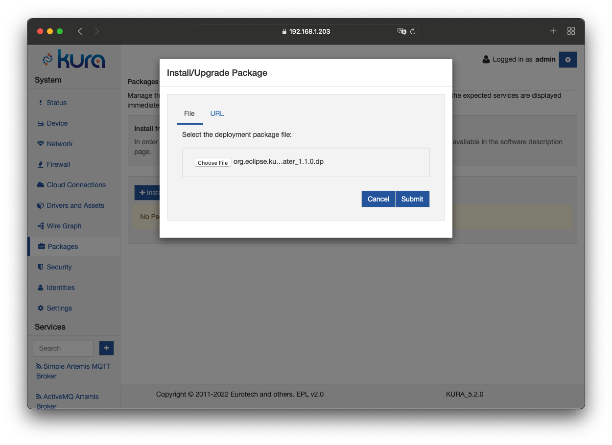
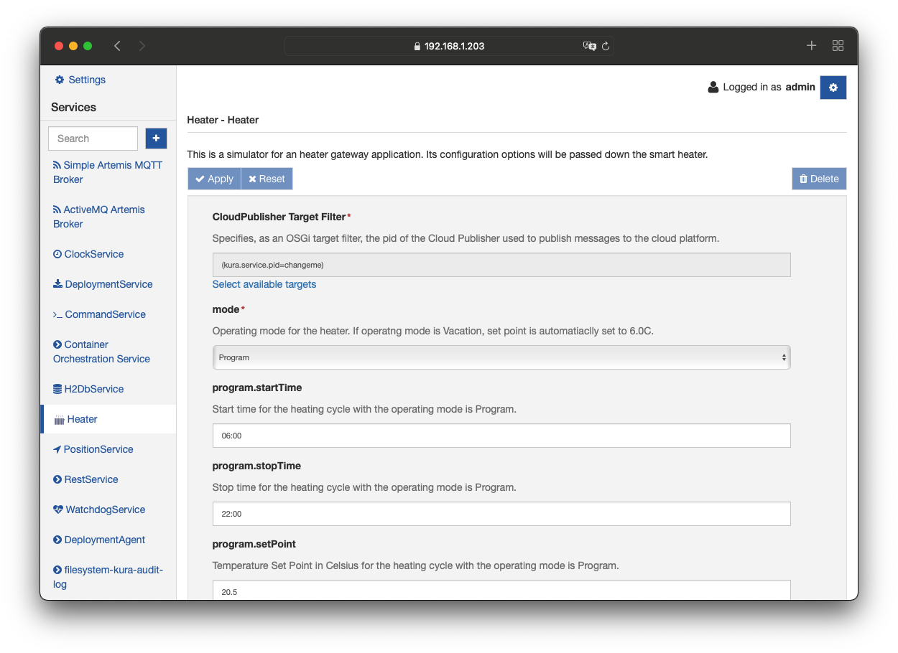
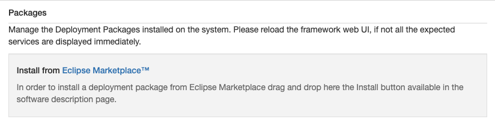
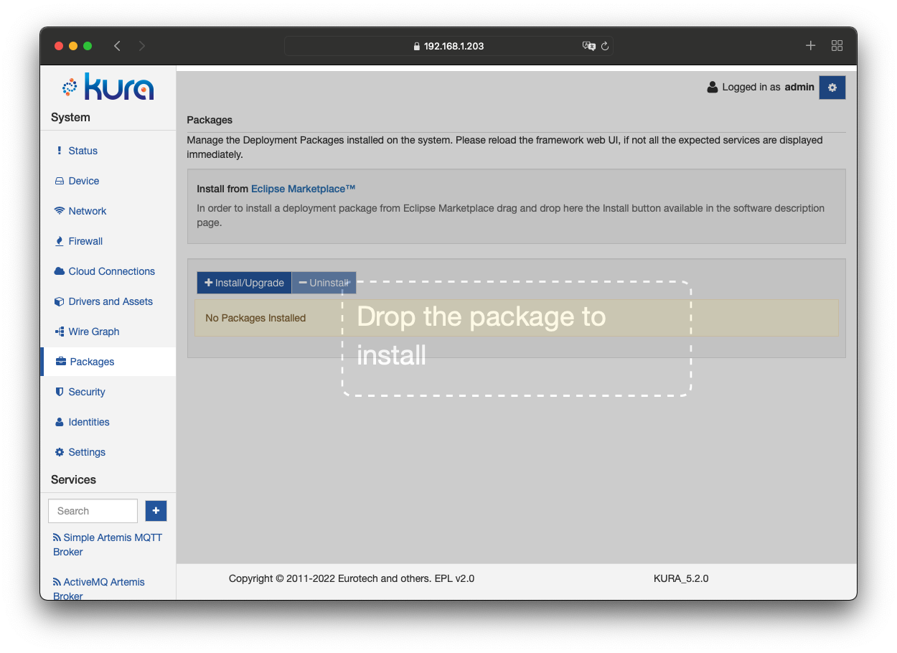
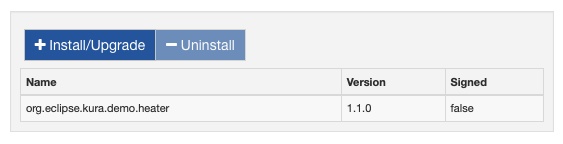

# Application Management

## Package Installation

After developing your application and generating a deployment package that contains the bundles to be deployed (refer to the Development section for more information), you may install it on the gateway using the **Packages** option in the **System** area of the Kura Gateway Administration Console as shown below.



Upon a successful installation, the new component appears in the Services list (shown as the _Heater_ example in these screen captures). Its configuration may be modified according to the defined parameters as shown the _Heater_ display that follows.



## Download Size Limit

The size of the files transferred to Kura, either downloaded from a remote server (e.g. using HTTP or HTTPS) or uploaded through the Kura Gateway Administration Console, is limited by the `file.transfer.size.max` Kura property. The limit applies to:

- files uploaded from the local machine through the Kura Gateway Administration Console:
    - deployment packages uploaded from the **Packages** page;
    - configuration snapshots uploaded with the [Upload and Apply](snapshot-management.md#upload-and-apply) option of the **Snapshots** tab in the **Settings** page;
    - zip archives uploaded with the **File** option of the [Command](../core-services/command-service.md) tab in the **Device** page;
    - channel lists uploaded with the [Upload Channels](../connect-field-devices/asset-implemetation.md#csv-upload) button of an Asset;
- packages installed from a URL or from the [Eclipse Kura Marketplace](#eclipse-kura-marketplace) through the **Packages** page of the Kura Gateway Administration Console;
- packages installed with the [Rest Deploy v2 API](../references/rest-apis/rest-deploy-api.md#install-package-from-url), when the provided URL refers to a remote server;
- deployment packages, shell scripts and verifier scripts downloaded through the [DEPLOY-V2](../references/mqtt-namespace.md#deploy-v2) cloud request handler.

The value is expressed in bytes and defaults to `26214400` (25 MB). Setting it to a negative value disables the limit, while setting it to `0` rejects any transfer.

The default value is defined in the `/opt/eclipse/kura/framework/kura.properties` file. To change it, add the property to the `/opt/eclipse/kura/user/kura_custom.properties` file, so that the new value is preserved across Kura updates. For example, to raise the limit to 50 MB:

```
file.transfer.size.max=52428800
```

Then restart Kura to apply the change.

!!! note
    Deployment packages already available on the device filesystem (i.e. referenced by a `file:` URL) are not subject to this limit.

!!! warning
    The `file.upload.size.max` property, previously used to limit the size of the files uploaded through the Kura Gateway Administration Console, is deprecated and no longer used. Use `file.transfer.size.max` instead.

## Eclipse Kura Marketplace

Kura allows the installation and update of running applications via the Eclipse Kura Marketplace.
The **Packages** page has, in the top part of the page a section dedicated to the Eclipse Kura Marketplace.

<figure markdown>
  { style="border-radius: 7px;"}
  <figcaption></figcaption>
</figure>

Dragging an application reference taken from the Eclipse Kura Marketplace to the specific area of the Kura Web Administrative Console will instruct Kura to download and install the corresponding package, as seen below:



!!! warning
    If the installation from the Eclipse Marketplace fails, it can be for the lack of the correct certificates. In this case, import the certificate in the _SSLKeystore_ from the _Certificate List_ tab under the _Security_ section. For more details about the procedure see [here](../../gateway-configuration/keys-and-certificates/).

    You can retrieve the proper certificate for the given bundle as follows: 
    
    - Identify the download link of the package to be installed from the Eclipse Kura Marketplace (for example, `https://download.eclipse.org/kura/releases/4.1.0/kura-4.1.0-deployment-package.dp`).
    - Retrieve the certificate with this command:
    ```bash
    openssl s_client -showcerts -connect download.eclipse.org:443  </dev/null 2>/dev/null | \
    sed -n '/-----BEGIN CERTIFICATE-----/,/-----END CERTIFICATE-----/p' | \
    sed -n '1,/-----END CERTIFICATE-----/p'
    ```

    the command will return an output like this:
    ```
    -----BEGIN CERTIFICATE-----
    MIIF2DCCA8CgAwIBAgIQBv6pX9+v6KX9v5r+V7fDzANBgkqhkiG99w0BAQsFADCB
    ...
    -----END CERTIFICATE-----   
    ```
    that can be imported in the _SSLKeystore_.

## Package Signature

Once the selected application deployment package (dp) file is installed, it will be listed in the **Packages** page and detailed with the name of the deployment package, the version and the signature status.
The value of the signature field can be **true** if all the bundles contained in the deployment package are digitally signed, or **false** if at least one of the bundles is not signed.

<figure markdown>
  { style="border-radius: 7px;"}
  <figcaption></figcaption>
</figure>
