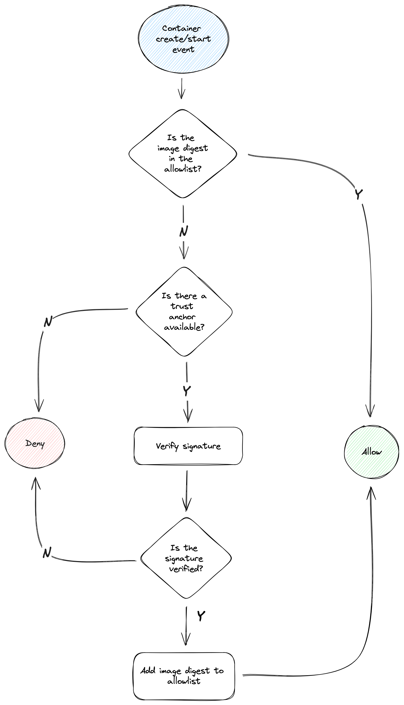
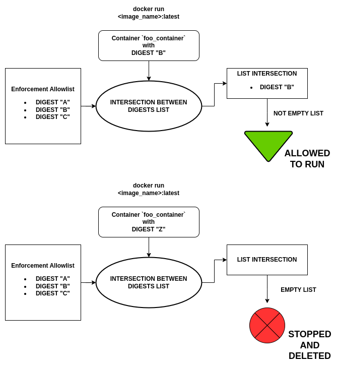
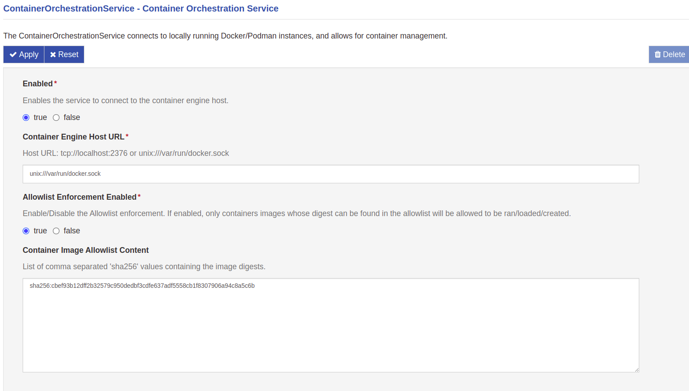
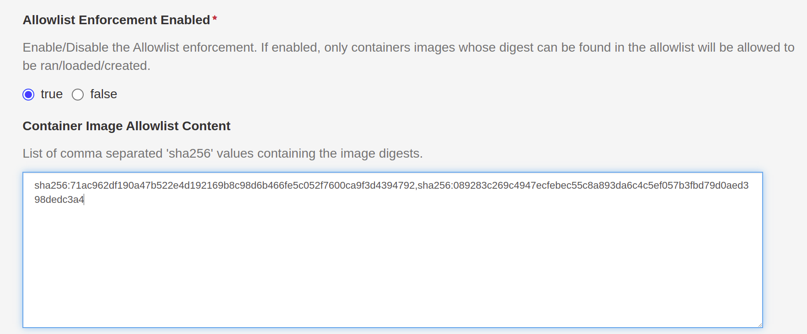
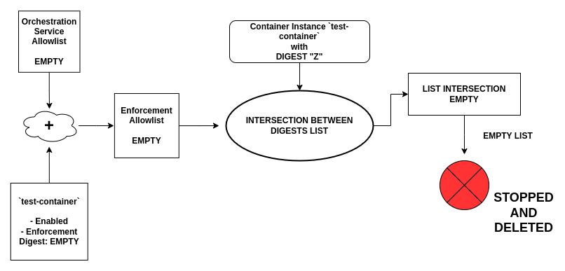
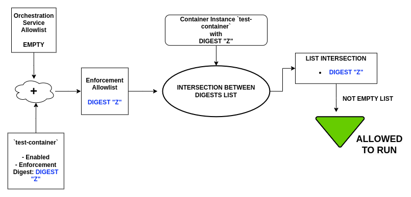
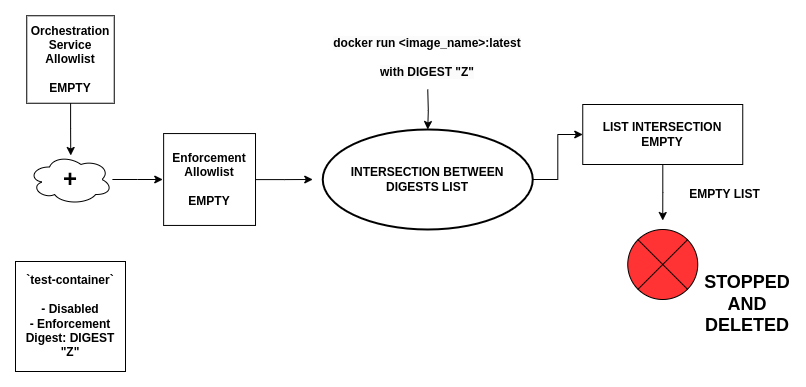
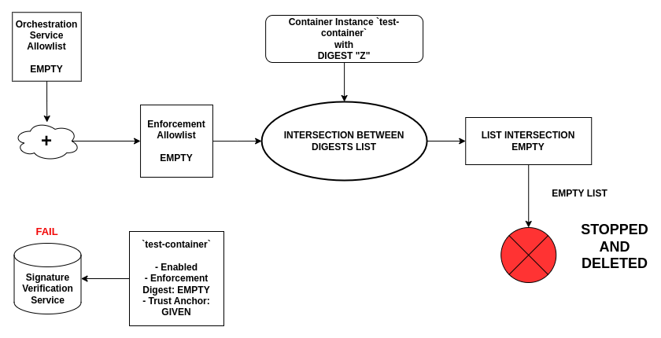
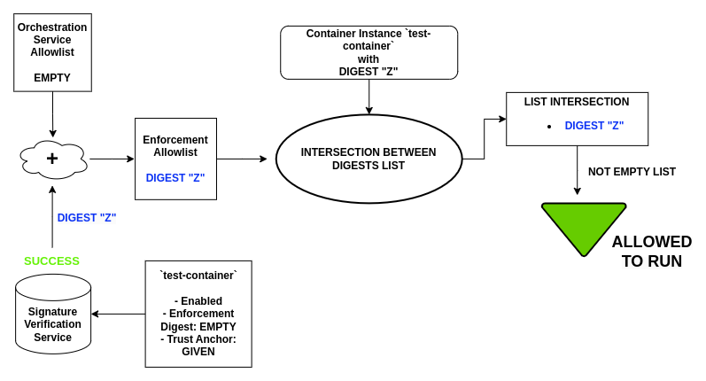

# Eclipse Eclipse Kura Container Image Authenticity and Allowlist Enforcement feature

Containerized applications are becoming increasingly popular in the software ecosystem as a way to deploy and distribute applications. As a result, ensuring the security of software supply chains has become a critical concern. Implementing best practices, such as signing and verifying images to mitigate man-in-the-middle (MITM) attacks and validating their authenticity and freshness, play a pivotal role in safeguarding the integrity of the software supply chain.

To ensure the authenticity and integrity of the code within the container images, binding the image to a specific entity or organization via signature verification is crucial and increasingly common.

The purpose of this document is to provide a high-level understanding of the Eclipse Kura container authenticity and allowlist enforcement feature introduced with **Eclipse Kura version 5.5.0**.

## High-level flow

The Eclipse Kura container authenticity and allowlist enforcement feature is designed to address container authenticity concerns by providing a mechanism to perform the signature verification of container images and restricting which container images can be deployed on the Eclipse Kura instance.

This is achieved by implementing the following flow:

{ width="600" }

Description of the flow:

- **Monitoring**: Eclipse Kura monitors the container engine events. When a "container start" event is triggered it intercepts the information regarding the image used to spin up the container and starts performing the container authenticity checks.
- **Allowlist**: Firstly, it checks if the digest of the image used to run the container can be found in the Eclipse Kura allowlist. If so, the container is allowed to run. If not, Eclipse Kura proceeds with the image signature verification.
- **Signature verification**: If no trust anchor (i.e. a public key or a X509 certificate depending on the signature mechanism) is available for the verification process to happen, the container is not allowed to run. If one is available, the image signature is verified and the allowlist is updated accordingly.

This flow applies to both containers managed by Eclipse Kura itself and containers ran directly by the user via CLI, allowing for a fine-grained control over the container images that can be deployed on the Eclipse Kura instance.

- **Unmanaged containers**: Eclipse Kura allows the user to define a list of container images that can be deployed on the platform. This is done by adding the image digests to the allowlist. When a container is started, Eclipse Kura checks if the image digest is in the allowlist and, if so, allows the container to run. This is meant to be used by users who, for any reason, need to run a container _outside_ the Eclipse Kura framework but still want the safety guarantees provided by pinning the images to a specific digest.
- **Managed containers**: For containers ran by the framework, Eclipse Kura also allows the user to provide a trust anchor to be used for the signature verification process. This allows the user to use a _mutable_ tag when specifying the container image, without giving up the required authenticity checks. Once the image is verified, its digest is stored within the Eclipse Kura allowlist, permitting it to be ran both from Eclipse Kura and the CLI without the need for an Internet connection. When a new image is published, the user can simply trigger the pull. The verification process will update the digest automatically.

Note that the user can still directly provide an image digest when running an Eclipse Kura-managed container. This will prevent the Eclipse Kura automatic signature verification process to run. This feature is meant to be used when:

- the user already ensured the image authenticity and does not want to go through the verification process again
- the image was not signed but the user still wants the enforcement trust guarantees provided by Eclipse Kura

## Unmanaged containers

Regarding the containers not managed by Eclipse Kura, the Container Orchestration service provides a security feature which enforces the containers allowed to run on the system. This feature can be enabled or disabled through the `Allowlist Enforcement Enabled` option.

This mechanism leverages the concept of _digest_, which is a unique and immutable identifier for a container image: it is therefore an excellent mean to identify the image from which a container was created.

Given the above, Eclipse Kura allows the user to provide a list of container image digests in the `Container Image Allowlist` field, in the form of newline-separated strings (see [Allowlist format](#allowlist-format)): when a container is started on the host system (whether it is launched by Eclipse Kura or by a terminal CLI), Eclipse Kura retrieves the image from which the container was created, extracts its digests and verifies that at least one of them is present in the allowlist provided during service configuration.

If one of the image digests is present in the allowlist, or has been provided by a Container Instance (see [Managed containers](#managed-containers)), the container is allowed to run without interference. Otherwise, it is forcibly removed from the host system (see [Enforcement behaviour](#enforcement-behaviour)).

A similar behaviour is performed at Eclipse Kura startup, when the enforcement is enabled at runtime and every time the Container Orchestration Service configuration changes while the enforcement is enabled: if there are already containers on the device (whether they are started or stopped), Eclipse Kura extracts the digests from the containers and compares them with those in the allowlist. Containers that have been created from images whose digests are in the allowlist are left untouched, otherwise they are removed.

The verification is performed by intersecting the list of digests of the container image and the list of allowed digests (the ones provided in the configuration plus the ones provided by the Container Instances): in this way, an empty intersection will result in a failing verification, while a non-empty one means that one of the image digests is equal to one of the allowed entries.



### Allowlist format

Enter one digest per line, e.g. `sha256:0000000000000000000000000000000000000000000000000000000000000000`. Spaces and empty lines are ignored; any other character (commas included) is part of the entry. Entries are not validated: a wrong entry simply never matches.

Use the image **repository digest**, not the image ID. Read it on the device with the command below and copy the part after `@`; a match on any of the listed digests is enough:

```bash
docker image inspect --format '{{json .RepoDigests}}' <image>
```

A new version of an image has a new digest: update the allowlist when you update the image.

!!! warning

    If the command prints an empty list, the image cannot be allowed and its containers are always removed. This depends on the container engine: e.g. with the Docker classic image store, a locally built image has no repository digest until it is pushed to a registry.

### Example scenarios

A user wants to leverage the container enforcement in order to let only docker containers started from an image named `foo_image` to be run on the device. To do this, they should enable the Container Enforcement by setting the `Allowlist Enforcement Enabled` to `true`, and fill the `Container Image Allowlist` field with the digest of the `foo_image` docker image (i.e.`sha256:0000000000000000000000000000000000000000000000000000000000000000` in the example below).



#### Startup of the Enforcement Feature

Let's suppose that on the device there are already two containers running, one created from the `foo_image` an one from an image named `unwanted_image` with digest `sha256:9999999999999999999999999999999999999999999999999999999999999999`. Once the enforcement starts with the configuration previously described, it extracts the digests of both containers and checks if they're included in the provided allowlist: in this case, the container originating from the `foo_image` will be allowed to run, while the one created from the `unwanted_image` will be removed, because its digest is not included in the allowlist.

The same happens also for already stopped containers: if the digest is verified, they'll be left in the descriptors list in the Stopped state, otherwise they'll be removed.

#### Running Container After Enforcement Feature Startup

After the starting phase just described, Eclipse Kura will continuously monitor the activity of the docker engine. Whenever a container is started on the device, it will check the image digest from which the container was created, comparing it to the ones inside the allowlist: if the container is created from the `foo_image` docker image, it will be allowed to run, otherwise it will be removed. If the user wants to add more than one allowed image, for example one named `wanted_image` with digest `sha256:1111111111111111111111111111111111111111111111111111111111111111`), it just needs to add it to the newline-separated list.




## Managed containers

As explained in the previous section, Managed Containers (i.e. `org.eclipse.kura.container.provider.ContainerInstance`s) support Container Signature validation. To do so a new API has been introduced: the [`ContainerSignatureValidationService`](https://github.com/eclipse/kura/blob/develop/kura/org.eclipse.kura.api/src/main/java/org/eclipse/kura/container/signature/ContainerSignatureValidationService.java).

Currently, there are three main mechanism for container signature verification:

- [Docker Content Trust (DCT)](https://docs.docker.com/engine/security/trust/) a.k.a. Notary V1
- [Notation](https://notaryproject.dev/) a.k.a. Notary V2
- [Sigstore's Cosign](https://docs.sigstore.dev/signing/quickstart/)

This newly introduced service allows Eclipse Kura to have multiple different Services implementing this interface and, thus, support all major signature mechanisms. A reference implementation for the `ContainerSignatureValidationService` is the `DummyContainerSignatureValidationService` available [in Kura `examples` folder](https://github.com/eclipse/kura/blob/develop/kura/examples/org.eclipse.kura.example.container.signature.validation/src/org/eclipse/kura/example/container/signature/validation/DummyContainerSignatureValidationService.java) for anyone wanting to implement an alternative `ContainerSignatureValidationService`.

When a `ContainerSignatureValidationService` is installed on Eclipse Kura, it gets automatically registered among the available validators and will be used to perform the signature validation. Under the hood, the `ContainerInstance` has a list of the available `ContainerSignatureValidationService` providers that, upon receiving a configuration update, it interrogates to check whether the requested container image is authentic using the provided **Trust Anchor**.

- If even _only one_ service reports the signature as valid, the image signature is considered valid.
- If none of the available services reports the signature as valid, the image signature is considered _not valid_.

This means that Eclipse Kura doesn't need to prompt the user for selecting the correct `ContainerSignatureValidationService` when performing the check.

Once the image signature is validated, the image digest is stored in the Eclipse Kura snapshot and added to the `ContainerOrchestratorService` allowlist (see section above). A container whose image digest is available in the allowlist won't be validated again, therefore after the initial check, the internet connection is no longer required for it to work.

### Example Scenarios

#### Container Instance Digest

Let's suppose to have a device on which Eclipse Eclipse Kura is running with the Container Orchestration Service enabled, its Enforcement feature disabled and a Container Instance named `test-container` up and running on the system.

A user wants to activate the Enforcement feature, so it enables the `Allowlist Enforcement Enabled` option in the Container Orchestration Service, but leaves the `Container Image Allowlist` option blank because it wants that no containers are started outside the framework.

As the feature starts, it checks all the containers on the device, including the `test-container`, which will be removed: this happens because the container digest is not included in the Container Orchestration Service Allowlist and the Container Instance is not providing any information through its `Container Image Enforcement Digest` option.



In order to allow the Container Instance, the user should provide the correct digest in the instance settings. Let's suppose that the digest of the image from which the container is created is `sha256:0000000000000000000000000000000000000000000000000000000000000000` and that the user fills the corresponding option with it: once the Container Instance is updated, the provided digest is included in the Enforcement feature allowlist, so the container will be allowed to run without interference. This case can be summarised as:



Once the instance digest is added to the enforcement feature, it can be used also to authorise containers run by the Command Line Interface, or by other instances on Eclipse Kura without providing the digest option. But what happens if the Container Instance is disabled? The aim of the Container Instance Enforcement Digest is to be used as an authorization method of the instance itself: this means that its digest is added to the enforcement feature allowlist **only while the container of the instance exists**, and the container of an instance exists only while the instance is enabled.



As it can be seen from the image, the merged `Enforcement Allowlist` box doesn't contain the digest associated to the Container Instance, because, being it disabled, the corresponding digest is ignored. If the enforcement is enabled and a container with digest *DIGEST Z* is started, it will then be removed, because its digest won't be included in the allowlist.

Finally, every time a *Container Image Enforcement Digest* option is modified, the ContainerInstance is disabled or deleted, or the container of the instance is removed, the enforcement feature will perform a check on all the containers. This is done because, if the digest that was previously provided has changed after an instance update, or has been removed due to disabling or deleting the instance, those containers that were previously authorised by this digest are no longer allowed to run. So they must be removed.

#### Lifetime of a Container Instance digest

The digest of a Container Instance (set in the option or obtained through [signature verification](#container-signature-verification)) is:

- **added** when Eclipse Kura starts the instance container, also if it is already running, and also while the enforcement is disabled;
- **removed** when the instance container is removed, by Eclipse Kura (instance disabled, deleted or reconfigured) or directly (e.g. `docker rm`). All the containers are then checked again;
- **kept in memory only**: after an Eclipse Kura restart, it is added again when the instance starts its container.

!!! warning

    The digests provided through Container Instances allow running also containers started by the **C**ommand**L**ine**I**nterface or by other Container Instances in the framework, even without providing the digest.
    
    If the ContainerInstance is disabled, deleted or reconfigured (any configuration change recreates its container), the containers that rely only on its digest can be removed, even if the digest did not change.

    The user needs to be careful, then, to rely only on the digests set in the ContainerInstances options. If the user will need to run containers from the CLI, it is preferable to use the allowlist of the Container Orchestration Service. For the Container Instances, it is a good practice to provide a digest.

#### Container Signature Verification

If the *Container Image Enforcement Digest* option is not provided, Eclipse Eclipse Kura will proceed with the Signature Verification: this process tries to extract the digest of the image from which the container was started.

Let's then suppose that we are back at the [beginning of the previous example](#container-instance-digest), with a blank Container Orchestration Service allowlist and a not given Container Instance Digest, but this time a *Trust Anchor* option is given: in this case Eclipse Eclipse Kura will start the Signature Verification Process, in order to extract the digest.

If, for whatever reason, the Signature Verification fails, no digests will be added to the allowlist: if the enforcement feature is enabled, the started container will be then removed by the enforcement feature, because no digests are included in the final Enforcement Allowlist.



While, if the procedure completes correctly, the extracted digest will be added to the Enforcement Allowlist and written in the snapshot: in this way the container will pass the enforcement feature check, and the obtained digest will be stored as part of the  Container Instance's configuration just started.



If the user wants to check again the digest through the Signature Verification Service, it just needs to erase the *Container Image Enforcement Digest* option from the configuration of the Container Instance: in this way the Signature feature will be triggered again and the digest recalculated.

!!! warning

    Even in this situation, the digest could be used to authenticate containers started from the CommandLineInterface: also in this case keep in mind that if the Container Instance is disabled, deleted or reconfigured, or if its container is removed, those CLI-based containers could be removed.

## Enforcement behaviour

- **When containers are checked**: all the containers (running or stopped) are checked when the enforcement starts or its configuration changes, when the enforcement monitor (re)connects to the container engine, and when a Container Instance digest is removed. A single container is checked when it starts. Failed checks and removals are retried every 10 seconds.
- **Removal**: rejected containers are force-removed (like `docker rm -f`): running containers are killed without a graceful stop. The enforcement does not prevent a container from starting: it removes it as soon as it detects it.
- **Connection loss**: if the connection to the container engine is lost (e.g. the engine restarts), Eclipse Kura reconnects every 10 seconds and then checks all the containers.
- **Disabling**: when the enforcement or the service is disabled, no check is performed and no container is removed. Containers started in the meantime are checked when the enforcement is enabled again.

## Troubleshooting

The enforcement activity is recorded in the audit log.

- **No `Enforcement started` entry** after a Kura startup or a configuration change: the enforcement is not active and is not retried, e.g. because the container engine was not reachable (`Could not connect to docker CLI.` in `kura.log`). Fix the cause, then restart Eclipse Kura or set `Allowlist Enforcement Enabled` to `false` and back to `true` (saving an unchanged configuration has no effect).
- **A container is unexpectedly removed**: check the `Enforcement rejected container` entry.
    - Digests listed: none of them is in the allowlist, check the [Allowlist format](#allowlist-format).
    - Empty list `[]`: the image has no repository digest, or the container no longer existed when checked (nothing was actually removed).
    - Preceded by `Enforcement digest ... unregistered`: the container relied on a Container Instance digest that has been removed.
- **After an unclean Eclipse Kura shutdown**, containers allowed only by a Container Instance digest can be removed at startup and then recreated by their instance. Add the digest to the `Container Image Allowlist` to avoid this.
