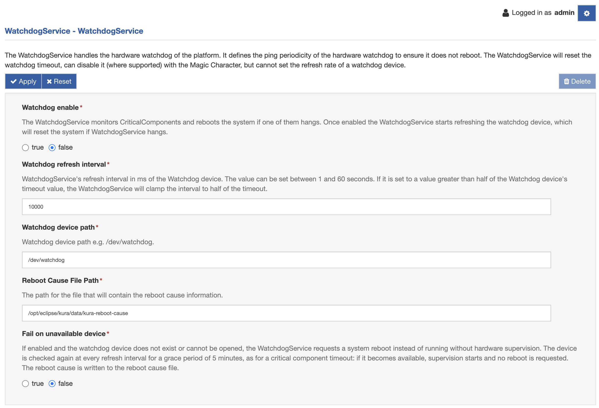

# Watchdog Service

The WatchdogService provides methods for starting, stopping, and updating a hardware watchdog if it is present on the system. Once started, the watchdog must be updated to prevent the system from rebooting.

To use this service, select the **WatchdogService** option located in the **Services** area as shown in the screen capture below.



This service provides the following configuration parameters:

- **enabled** - sets whether or not this service is enabled or disabled. (Required field)

- **pingInterval** - defines the time interval (in milliseconds) between two watchdog refreshes. (Required field) The value can be set between 1 and 60 seconds. The service reads the **watchdog timeout** from the watchdog device: if the interval is greater than half of that timeout, the service logs a warning and refreshes the device every half of the timeout instead, so that a misconfigured interval does not result in a system reboot. If the timeout cannot be read from the device, the configured interval is used as is. On most systems, you can check the watchdog timeout using the following command:
    ```bash
    wdctl <watchdog-device>
    ```
    The `wdctl` tool allows to change the default timeout value. Refer to specific [man page](https://man7.org/linux/man-pages/man8/wdctl.8.html) for details.

- **Watchdog device path** - sets the watchdog device path. (Required field)

- **Reboot Cause File Path** - sets the path to the file that will contain the reboot cause information. (Required field)

- **Fail on unavailable device** - sets the behaviour of the service when it is enabled but the watchdog device does not exist or cannot be opened. If disabled (default), the service keeps running without hardware supervision. If enabled, the service requests a system reboot as described in [Unavailable watchdog device](#unavailable-watchdog-device). (Required field)

When the configuration is updated, the watchdog device is disarmed and reopened only if the **enabled** or the **Watchdog device path** parameters change. A change to the other parameters is applied without interrupting the hardware supervision. An update that does not change any value is ignored.

## Reboot on critical component timeout

When a registered [CriticalComponent](../java-application-development/how-to-use-watchdog.md) does not check in within its timeout, the service writes the reboot cause to the **Reboot Cause File Path** and requests a system reboot. Then:

- if the reboot command is accepted, the service keeps refreshing the watchdog device for a grace period of 5 minutes to allow a clean shutdown. After that it stops refreshing, so that the hardware watchdog resets the system if the shutdown hangs;
- if the reboot command fails, the service stops refreshing the watchdog device immediately and the hardware watchdog resets the system when its timeout expires.

## Unavailable watchdog device

If the service is enabled but the watchdog device does not exist or cannot be opened, the system is not under hardware watchdog supervision. The service reports this condition in the log and through the [watchdog status](#watchdog-status).

If **Fail on unavailable device** is enabled, the service additionally checks the device again at every **pingInterval** for a grace period of 5 minutes:

- if the device becomes available, the supervision starts and no reboot is requested;
- if the device is still unavailable at the end of the grace period, the service writes the reboot cause to the **Reboot Cause File Path** and requests a system reboot. Since in this case there is no hardware watchdog that can enforce the reset, a failed reboot command is retried every minute until it succeeds.

## Watchdog status

The state of the hardware supervision is available to the applications through the `getWatchdogStatus()` method of the `WatchdogService` API. The supervision can be in one of the following states:

| State | Description |
| - | - |
| `DISABLED` | The service is disabled by configuration and does not supervise the system. |
| `SUPERVISING` | The watchdog device is open and it is periodically refreshed. This is the only state in which the system is under hardware watchdog supervision. |
| `DEVICE_UNAVAILABLE` | The service is enabled but the watchdog device does not exist or cannot be opened. If **Fail on unavailable device** is enabled, this is also the state during the grace period that precedes the reboot request. |
| `REBOOT_REQUESTED` | A system reboot has been requested, either because a critical component timed out or because the watchdog device is still unavailable at the end of the grace period. The state is kept while a failed reboot is being retried. |

Refer to [How to use watchdog](../java-application-development/how-to-use-watchdog.md#watchdog-status) for the details on the information reported by the status and for a code example.
