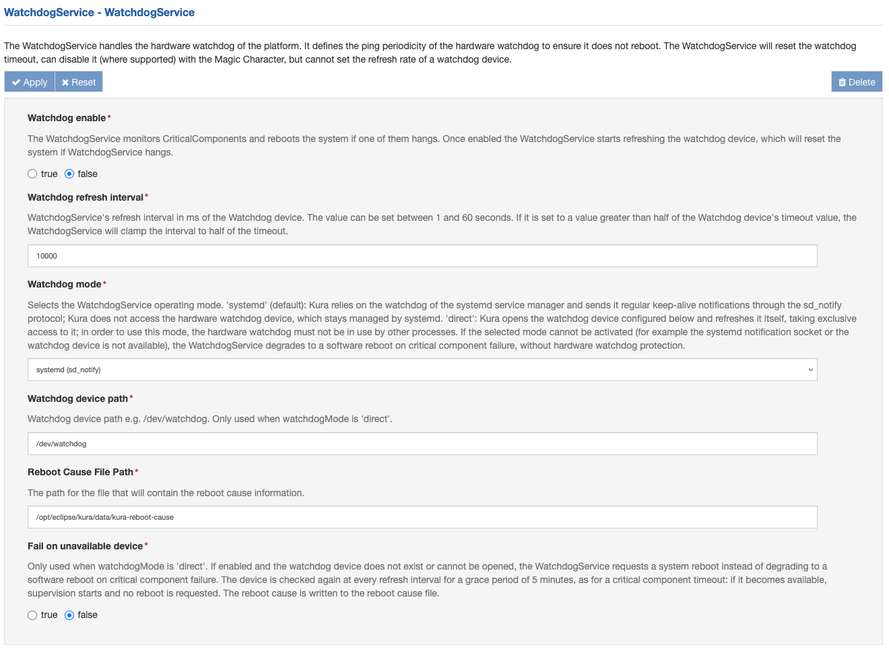

# Watchdog Service

The WatchdogService supervises the gateway and triggers a reboot whenever Kura or an application registered as a [CriticalComponent](../java-application-development/how-to-use-watchdog.md) stops functioning. Once enabled, the service must continuously refresh its watchdog timer; failure to do so results in a system reboot.

The service supports two distinct watchdog backends, selectable via the **Watchdog mode** parameter:

- **systemd** (default) - Kura sends regular keep-alive notifications to the systemd service manager, which supervises the Kura service.
- **direct** - Kura opens the hardware watchdog device and refreshes it itself.

Refer to [Watchdog modes](#watchdog-modes) for the details.

To use this service, select the **WatchdogService** option located in the **Services** area as shown in the screen capture below.



This service provides the following configuration parameters:

- **enabled** - sets whether or not this service is enabled or disabled. (Required field)

- **pingInterval** — Required field. Specifies the interval (in milliseconds) between two consecutive watchdog refreshes. The accepted range is 1 to 60 seconds. The service compares this interval against the timeout of the selected watchdog. If the configured interval exceeds half of that timeout, the service logs a warning and instead refreshes the watchdog at half the timeout value. This prevents a misconfigured interval from causing an unintended system reboot.
    - In **systemd** mode this parameter defines the interval between two keep-alive notifications sent to systemd. The timeout is the `WatchdogSec` value of the Kura unit if set, otherwise three times this interval; see [systemd mode](#systemd-mode) for more details.
    - In **direct** mode the timeout is read from the watchdog device. If it cannot be read, the configured interval is used as is. On most systems, you can check the watchdog timeout using the following command:
        ```bash
        wdctl <watchdog-device>
        ```
        The `wdctl` tool allows to change the default timeout value. Refer to specific [man page](https://man7.org/linux/man-pages/man8/wdctl.8.html) for details.

- **Watchdog mode** - selects the watchdog used by the service: `systemd` (default) or `direct`. (Required field)

- **Watchdog device path** - sets the watchdog device path. Only used in **direct** mode. (Required field)

- **Reboot Cause File Path** - sets the path to the file that will contain the reboot cause information. (Required field)

- **Fail on unavailable device** — used only in **direct** mode. This setting controls how the service behaves when it is enabled but the watchdog device is missing or cannot be opened. When disabled (the default), the service continues running without hardware supervision. When enabled, the service triggers a system reboot, as described in [Unavailable watchdog device](#unavailable-watchdog-device). (Required field)

In **direct** mode, a configuration update disarms and reopens the watchdog device only if one of the following parameters is changed: **Enabled**, **Watchdog mode**, or **Watchdog device path**. Changes to any other parameters are applied without interrupting hardware supervision. If an update does not modify any parameter value, it is ignored.

!!! warning
    The default **Watchdog mode** is `systemd`. If an existing installation previously used the hardware watchdog device directly through Kura before this parameter was introduced, it must set **Watchdog mode** to `direct` to retain that behavior. Otherwise, the watchdog will be managed by systemd.

## Watchdog modes

### systemd mode

In this mode Kura does not access the hardware watchdog device. At every **pingInterval** it sends a keep-alive notification to systemd through the `sd_notify` protocol, using the `systemd-notify` command. If the notifications stop, for example because Kura hangs, systemd terminates the Kura service when the service watchdog timeout expires and the Kura unit reboots the system.

The timeout of the systemd service watchdog is defined as follows:

- if the `kura.service` unit sets `WatchdogSec=`, that value is used. In this case systemd supervises Kura also while it is starting, so the value must be longer than the Kura startup time;
- otherwise, which is the default of the Kura installer, the service asks systemd for a timeout of three times the **pingInterval** when it is enabled. The supervision starts when the WatchdogService is activated, so the Kura startup is not supervised.

When the service is disabled by configuration, or the **Watchdog mode** is changed, Kura turns off the service watchdog that it requested. If instead the WatchdogService is stopped while it is enabled, for example because its bundle is stopped, the supervision is not turned off: the timeout is raised to 5 minutes, and the system is rebooted if the service is not running again by then.

The hardware watchdog of the platform is managed by systemd and it is configured with the `RuntimeWatchdogSec=` option of the systemd [system configuration](https://www.freedesktop.org/software/systemd/man/latest/systemd-system.conf.html). The Kura installer does not change this option:

- if it is set, the hardware watchdog resets the system when systemd itself or the kernel hang;
- if it is not set, the system is still rebooted when Kura hangs or a critical component times out, but it is not protected by the hardware watchdog.

This mode requires Kura to be started by systemd as a service and the `systemd-notify` command to be installed. If one of them is missing the service runs in [degraded mode](#degraded-mode).

### direct mode

In this mode Kura opens the device set in **Watchdog device path** and refreshes it at every **pingInterval**. If the refreshes stop, the hardware watchdog resets the system.

The watchdog device can be opened by a single process, so it must not be in use by other programs. In particular, systemd must not be configured to manage the same device with `RuntimeWatchdogSec=`. The Kura installer does not change the systemd watchdog configuration.

When Kura is stopped while the service is enabled, the watchdog device is closed without being disarmed, so that the system is reset if Kura does not start again. As a consequence, restarting Kura resets the system if Kura takes longer than the hardware watchdog timeout to start and open the device again.

If the device does not exist or cannot be opened, the service behaves as described in [Unavailable watchdog device](#unavailable-watchdog-device).

### Degraded mode

If the selected mode cannot be activated, for example because the systemd notification socket or the watchdog device is not available, the service runs in degraded mode: it still requests a system reboot when a critical component times out, but nothing reboots the system if Kura itself hangs. This condition is reported in the log and through the [watchdog status](#watchdog-status).

## Reboot on critical component timeout

When a registered [CriticalComponent](../java-application-development/how-to-use-watchdog.md) does not check in within its timeout, the service writes the reboot cause to the **Reboot Cause File Path** and requests a system reboot. Then:

- if the reboot command is accepted, the service keeps refreshing the watchdog for a grace period of 5 minutes to allow a clean shutdown. After that it stops refreshing, so that the system is reset if the shutdown hangs: by the hardware watchdog in **direct** mode, by systemd in **systemd** mode;
- if the reboot command fails, the service stops refreshing the watchdog immediately:
    - in **direct** mode the hardware watchdog resets the system when its timeout expires;
    - in **systemd** mode systemd terminates Kura when the service watchdog timeout expires and the Kura unit reboots the system. Until then the reboot command is retried every minute;
    - in [degraded mode](#degraded-mode) there is no watchdog that can enforce the reset, so the reboot command is retried every minute until it succeeds.

## Unavailable watchdog device

This section applies to the **direct** mode.

If the service is enabled but the watchdog device does not exist or cannot be opened, the system is not under hardware watchdog supervision. The service reports this condition in the log and through the [watchdog status](#watchdog-status).

If **Fail on unavailable device** is enabled, the service additionally checks the device again at every **pingInterval** for a grace period of 5 minutes:

- if the device becomes available, the supervision starts and no reboot is requested;
- if the device is still unavailable at the end of the grace period, the service writes the reboot cause to the **Reboot Cause File Path** and requests a system reboot. Since in this case there is no hardware watchdog that can enforce the reset, a failed reboot command is retried every minute until it succeeds.

## Watchdog status

The state of the supervision is available to the applications through the `getWatchdogStatus()` method of the `WatchdogService` API. The supervision can be in one of the following states:

| State | Description |
| - | - |
| `DISABLED` | The service is disabled by configuration and does not supervise the system. |
| `SUPERVISING` | The watchdog is periodically refreshed. In **direct** mode the watchdog device is open and the system is under hardware watchdog supervision. In **systemd** mode Kura is sending keep-alive notifications to systemd; whether the system is also under hardware watchdog supervision depends on the systemd configuration. |
| `DEVICE_UNAVAILABLE` | The service is enabled but the selected watchdog cannot be used: in **direct** mode the watchdog device does not exist or cannot be opened, in **systemd** mode the notification socket or the `systemd-notify` command is not available. If **Fail on unavailable device** is enabled, this is also the state during the grace period that precedes the reboot request. |
| `REBOOT_REQUESTED` | A system reboot has been requested, either because a critical component timed out or because the watchdog device is still unavailable at the end of the grace period. The state is kept while a failed reboot is being retried. |

Refer to [How to use watchdog](../java-application-development/how-to-use-watchdog.md#watchdog-status) for the details on the information reported by the status and for a code example.
