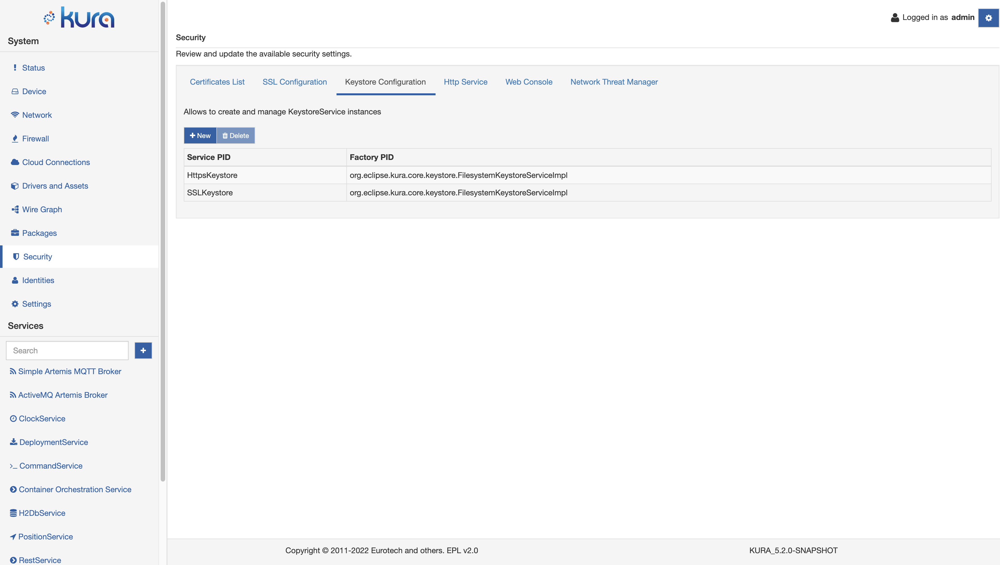
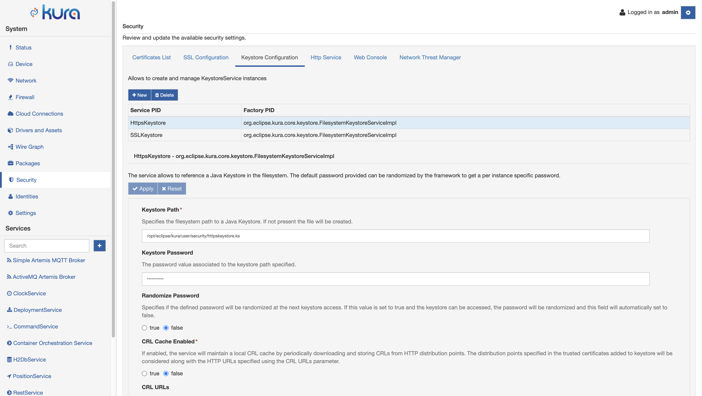

# Keystores Management

The framework manages different types of cryptographic keys and certificates. In order to simplify the interaction with those objects, Kura provides a KeystoreService API and a specific section in the Kura Web UI that lists all the available KeystoreService instances.

From the Security section, a user with Security permissions can access the **Keystore Configuration** section. A list of all the framework managed keystores will be available to the user with the **Service PID** that will be used by other components to reference the selected keystore. Associated to the Service PID, the UI shows the **Factory PID** that identifies the specific KeystoreService API implementation that is providing the service to the framework.

In order to modify the configuration of a specific keystore service instance, the user can select one of the available rows, obtaining the corresponding keystore service configuration.

The following KeystoreService factories are available:

## FilesystemKeystoreServiceImpl

The `org.eclipse.kura.core.keystore.FilesystemKeystoreServiceImpl` factory provides a KeystoreService implementation that stores the private keys and certificates as a file. The user can customise the following options:

- **Keystore Path**: identifies the path in the filesystem. If the keystore file does not exists, a new file will be created. The value cannot be empty.
- **Keystore Password**: the corresponding keystore password.
- **Randomize Password**: a boolean flag that allows the user to specify if the keystore password needs to be randomised at the next framework boot. If set **true**, the framework will try to access the identified keystore and randomise the password. The new password will be persisted in the framework snapshot. Once successfully randomised, the flag will be automatically set to false by the framework.

## PKCS11KeystoreServiceImpl

The `org.eclipse.kura.core.keystore.PKCS11KeystoreServiceImpl` factory provides a KeystoreService implementation that allows to access a PKCS11 token through the SunPKCS11 implementation.

At the moment this type of KeystoreService provides read only access to the underlying token, operations such as adding or removing entries will fail.

It is possible to use the entries provided by a `PKCS11KeystoreServiceImpl` for SSL authentication.

The available configuration options closely match the parameters provided by the SunPKCS11 implementation, see the [official documentation](https://docs.oracle.com/javase/8/docs/technotes/guides/security/p11guide.html) for more details.

In particular, the official documentation contains a [section](https://docs.oracle.com/javase/8/docs/technotes/guides/security/p11guide.html#KeyStoreRestrictions) that explains how the PKCS11 objects are mapped to Java KeyStore entries.

The only required parameter is the **PKCS11 Implementation Library Path** parameter. It is usually also necessary to specify the token user pin as the **Pin** parameter.

The configuration parameters are mapped to the SunPKCS11 provider parameters in the following way:

|**Kura Parameter**|**SunPKCS11 Parameter**|**Notes**|
|-|-|-|
|**Slot**|slot||
|**Slot List Index**|slotListIndex||
|**Enabled Mechanisms**|enabledMechanisms|The curly braces must be omitted|
|**Disabled Mechanisms**|disabledMechanisms|The curly braces must be omitted.|
|**Attributes**|attributes|The value of this field will be appended to the provider configuration.|

## CRL Management

Both KeystoreService factories can keep a local cache of Certificate Revocation Lists (CRLs). The cached CRLs are returned by the `getCRLs()` and `getCRLStore()` methods of the KeystoreService API, and the HTTP Service and the SSL Manager Service use them in the revocation check of the certificates they validate.

The following options are available:

- **CRL Cache Enabled**: enables the CRL cache. The default is `true`.
- **CRL URLs**: up to five URLs to download CRLs from. The service also downloads the CRLs of the distribution points listed in the trusted certificates of the keystore.
- **CRL Force Update Interval** and **CRL Force Update Interval Time Unit**: a cached CRL is downloaded again when its last successful download is older than this interval, even if its next update date has not passed. The default is 1 day.
- **CRL Check Interval** and **CRL Check Interval Time Unit**: how often the cached CRLs are checked and downloaded again if needed. The default is 5 minutes. The service never checks more often than every 30 seconds.
- **CRL Store Path**: the file where the cached CRLs are persisted. If it is empty, the `FilesystemKeystoreServiceImpl` adds a `.crl` suffix to the **Keystore Path**, and the `PKCS11KeystoreServiceImpl` uses `security/pkcs11.<pid>.crl` in the user configuration directory.
- **Enable CRL Verification**: if `true`, a downloaded CRL is stored only if it is signed by the trusted certificate of its issuer in this keystore, that is the trusted certificate whose subject is the CRL issuer. The default is `true`.
- **Reject Expired CRLs**: if `true`, a CRL whose next update date has passed is not stored when it is downloaded or added, and a cached CRL is no longer returned once it expires, so the revocation status of the certificates it covers cannot be determined until a valid CRL is downloaded. The default is `false`: an expired CRL is kept and returned until a newer one is downloaded, and the certificate validation decides how to treat it.

A CRL is downloaded when the service starts or its configuration changes, when no CRL has been downloaded yet from the distribution point, when the cached CRL has expired or its next update date is closer than the **CRL Force Update Interval**, and when its last successful download is older than the **CRL Force Update Interval**.

A downloaded CRL is stored only if all the following conditions hold:

- if the distribution point comes from a trusted certificate, the CRL is issued by the issuer of that certificate, or by the CRL issuer named in the distribution point. Such a CRL replaces a cached CRL of another issuer;
- if the distribution point comes from the **CRL URLs** option and a CRL is already cached for it, the new CRL has the same issuer;
- the CRL is not older than the cached CRL of the same issuer: a CRL with a lower CRL number, or with an earlier this update date, is ignored;
- the CRL passes the checks enabled by **Enable CRL Verification** and **Reject Expired CRLs**.
