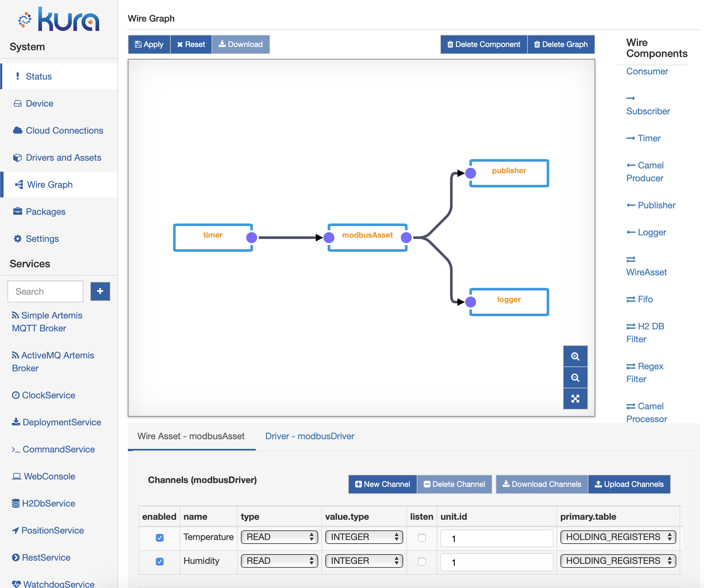

---
hide:
  - feedback
---
<figure markdown>
  
  <figcaption></figcaption>
</figure>

# Welcome to the Eclipse Kura™ Documentation

Eclipse Kura™ turns an edge device into a managed IoT gateway. It collects data from field devices, processes it at the edge and delivers it to the cloud, while the gateway itself stays configurable, secure and manageable: locally from its web console and REST APIs, remotely from an IoT platform over MQTT.

Kura is a Java 21 application built on OSGi. Every feature is a configurable OSGi Declarative Services component that exposes a service API, so you can extend the gateway with your own add-ons, drivers and containerized applications.

-   :material-download-circle-outline:{ .lg .middle } __Install__

    ---

    Install Kura from the Eclipse Kura APT repository on Debian-based arm64 and amd64 systems, or start the Docker image.

    [:octicons-arrow-right-24: Install Kura](getting-started/install-kura.md)

-   :material-monitor-dashboard:{ .lg .middle } __Configure the gateway__

    ---

    Set up network interfaces, firewall, cloud connections, certificates and users from the web console.

    [:octicons-arrow-right-24: Gateway Administration Console](gateway-configuration/gateway-administration-console.md)

-   :material-chip:{ .lg .middle } __Connect field devices__

    ---

    Read and write industrial and IoT devices through Drivers and Assets: OPC UA, S7, Modbus, GPIO, Bluetooth LE, CAN.

    [:octicons-arrow-right-24: Drivers, Assets and Channels](connect-field-devices/driver-and-assets.md)

-   :material-transit-connection-variant:{ .lg .middle } __Process data with Wires__

    ---

    Build data pipelines by wiring components together: acquire, filter, store, run AI inference and publish.

    [:octicons-arrow-right-24: Kura Wires](kura-wires/introduction.md)

-   :material-cloud-upload-outline:{ .lg .middle } __Connect to the cloud__

    ---

    Publish telemetry and accept remote management through Eclipse Kapua, Eclipse Hono, Sparkplug B or any MQTT broker.

    [:octicons-arrow-right-24: Cloud Connections](cloud-api/overview.md)

-   :material-code-braces:{ .lg .middle } __Build your add-on__

    ---

    Generate a project with the Kura Addon Archetype, then build, package and deploy it to your gateway.

    [:octicons-arrow-right-24: Hello World Application](java-application-development/hello-world-application.md)

## Architecture

Select the diagram to open it at full size. Read it from the bottom up. Kura runs on Linux, on a Java 21 runtime, inside the Eclipse Equinox OSGi framework. The **Kura API** (`org.eclipse.kura.api`) defines the service contracts that `kura-core` and the add-ons implement. Solid boxes ship with the `kura-core` package, dashed boxes are add-ons installed by the `kura` meta-package, dotted boxes are optional add-ons.

| Layer | What it provides | Learn more |
| --- | --- | --- |
| **Device Abstraction** | Serial ports, USB and HID devices in the core; GPIO (libgpiod), GPS (gpsd), Bluetooth LE (BlueZ) and CAN (SocketCAN) from their add-ons | [Serial Ports](java-application-development/how-to-serial-ports.md), [GPIO](java-application-development/how-to-use-gpio.md), [Bluetooth LE](java-application-development/how-to-use-bt-le-apis.md), [CAN bus](java-application-development/how-to-use-can-bus.md) |
| **Basic Gateway Services** | Configuration and snapshots, system information and inventory, H2 and SQLite databases, clock synchronization, watchdog, position | [Configuration Service](core-services/configuration-service.md), [Snapshots](administration/snapshot-management.md), [Inventory](administration/system-component-inventory.md) |
| **Security** | Crypto service, file and PKCS#11 keystores, certificates and CRLs, identities and permissions, JWT tokens, tamper detection | [Crypto Service](core-services/crypto-service.md), [Keystores](gateway-configuration/keystores-management.md), [Authentication and Authorization](gateway-configuration/authentication-and-authorization.md) |
| **Network Configuration** | Ethernet, Wi-Fi, cellular and VLAN interfaces through NetworkManager and ModemManager, firewall and NAT, network threat manager | [Network Configuration](gateway-configuration/network-configuration.md), [Firewall](gateway-configuration/firewall-configuration.md) |
| **Containers** | Docker and Podman container orchestration, image signature verification, authenticated registries | [Container Orchestration](core-services/container-orchestration-provider.md) |
| **Connectivity & Delivery** | Multiple cloud connections (Eclipse Kapua, Eclipse IoT, Raw MQTT, Sparkplug B), store-and-forward data service, embedded Artemis MQTT broker | [Cloud Connection API](cloud-api/overview.md), [Sparkplug](cloud-platform/kura-sparkplug.md) |
| **Assets & Drivers** | Driver API and helpers in the core; OPC UA, S7, Modbus, GPIO, Bluetooth LE and CAN drivers and protocols as add-ons | [Drivers and Assets](connect-field-devices/driver-and-assets.md), [Field Protocols](connect-field-devices/field-protocols.md) |
| **Applications** | Your Java add-ons, containerized applications, Kura Wires data flows, AI inference with Nvidia Triton | [Kura Wires](kura-wires/introduction.md), [Triton Inference Engine](core-services/nvidia-triton-server-inference-engine.md) |

## Kura core and add-ons

Since version 6.0.0 Kura is made of a mandatory core and a set of add-ons, each developed in its own repository and shipped as its own Debian package. Installing the `kura` meta-package gives you `kura-core` plus the add-ons that make up the complete gateway; the optional add-ons can be installed when you need them.

| Package | What it adds | Installed by `kura` |
| --- | --- | --- |
| [kura-core](https://github.com/eclipse-kura/kura) | Kura API, configuration, security, cloud connections, REST APIs, containers, databases | Yes, mandatory |
| [kura-management-ui](https://github.com/eclipse-kura/kura-management-ui) | Web console | Yes |
| [kura-networking](https://github.com/eclipse-kura/kura-networking) | Network interfaces, firewall and network threat manager | Yes |
| [kura-wires](https://github.com/eclipse-kura/kura-wires) | Kura Wires and Assets | Yes |
| [kura-artemis](https://github.com/eclipse-kura/kura-artemis) | Embedded Apache ActiveMQ Artemis MQTT broker | Yes |
| [kura-bluetooth](https://github.com/eclipse-kura/kura-bluetooth) | Bluetooth LE, iBeacon™ and Eddystone™, BLE drivers | Yes |
| [kura-position](https://github.com/eclipse-kura/kura-position) | Position service based on gpsd | Yes |
| [kura-command](https://github.com/eclipse-kura/kura-command) | Remote command execution | Yes |
| [kura-deployment](https://github.com/eclipse-kura/kura-deployment) | Remote installation of deployment packages | Optional |
| [kura-gpio](https://github.com/eclipse-kura/kura-gpio) | GPIO service and driver based on libgpiod | Optional |
| [kura-opcua](https://github.com/eclipse-kura/kura-opcua), [kura-s7](https://github.com/eclipse-kura/kura-s7) | OPC UA and S7comm drivers | Optional |
| [kura-modbus](https://github.com/eclipse-kura/kura-modbus), [kura-can](https://github.com/eclipse-kura/kura-can) | Modbus and CAN bus protocols | Optional |
| [kura-camel](https://github.com/eclipse-kura/kura-camel) | Apache Camel™ integration | Optional |
| [kura-triton](https://github.com/eclipse-kura/kura-triton) | Nvidia™ Triton Server inference engine | Optional |
| [kura-log-filesystem](https://github.com/eclipse-kura/kura-log-filesystem) | Filesystem log provider | Optional |
| [kura-apps](https://github.com/eclipse-kura/kura-apps) | Example applications and prototypes | Optional |

!!! tip "Install only what you need"
    `kura-core` can also be installed on its own, together with the add-ons your gateway needs. The [Install Kura](getting-started/install-kura.md#kura-packages) page lists the system dependencies of each package.

## One API, two ways in

Most REST resources are also registered as MQTT request handlers. A script calling `/services/configuration/v2` over HTTPS and a cloud platform sending a request to `CONF-V2` over MQTT run the same code, so everything you automate locally can also be done remotely. The same applies to keystores (`KEYS-V2`), identities (`IDN-V2`), security (`SEC-V2`), system information (`SYS-V1`), inventory (`INVENTORY-V1`) and cloud connections (`CLD-V1`).

[:octicons-arrow-right-24: REST Service](core-services/rest-service.md) · [:octicons-arrow-right-24: MQTT Namespace](references/mqtt-namespace.md) · [:octicons-arrow-right-24: Remote Management with Eclipse Kapua](administration/remote-management-kapua.md)

## Data flows with Kura Wires

Kura Wires lets you design data pipelines from the web console by placing components on a graph and wiring them together. A typical flow polls an Asset, stores the records in the gateway database, filters or aggregates them with SQL or JavaScript, and publishes the result to the cloud.

## More resources

- [Javadoc](references/javadoc.md) of the Kura API
- [Eclipse Kura™ GitHub organization](https://github.com/eclipse-kura), with the repositories of the core and of every add-on
- [Eclipse Kura™ Apache ActiveMQ Artemis MQTT broker addon](https://eclipse-kura.github.io/kura-artemis) documentation

??? info "Coming from Kura 5?"
    - Kura 6 requires **Java 21**.
    - The framework is split into `kura-core` and add-ons: networking, web console, Wires and Assets, Bluetooth, position and command moved out of the core into the packages listed above.
    - Remote installation of deployment packages (`DEPLOY-V2`) is provided by the optional `kura-deployment` add-on.
    - Apache Camel™, the S7comm and OPC UA drivers, Modbus, CAN, the filesystem log provider and the Nvidia™ Triton integration are developed in their own repositories.
    - Deprecated APIs have been removed from `org.eclipse.kura.api`: check the [Javadoc](references/javadoc.md) before porting an add-on.
    - Add-ons are built with Maven and bnd: start from the [Kura Addon Archetype](java-application-development/kura-addon-archetype.md).
