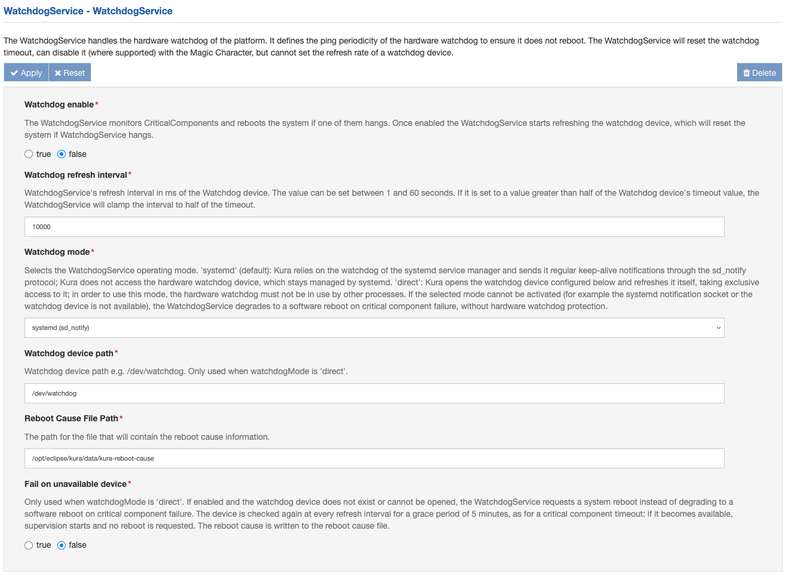

# How to use watchdog

## Overview

When enabled, the watchdog is a monitor that will reboot the system if it is not refreshed during a certain time interval. In Kura, the WatchdogService can be used by critical applications. If the specified application is alive, the service notifies the watchdog; if the application is down, the service requests a system reboot and stops notifying the watchdog, so that the system is reset even if the reboot does not complete.

The WatchdogService can use two different watchdogs, selected with the **Watchdog mode** parameter:

* **systemd** (default) - the service sends keep-alive notifications to the systemd service manager, which supervises Kura. Kura does not access the watchdog device.

* **direct** - the service notifies the kernel watchdog driver using the /dev/watchdog device file. You can verify that the watchdog driver is installed using the following command:

    ```shell
    ls –l /dev/watchdog
    ```


## Configuration

To configure the **WatchdogService**, select the WatchdogService option located in the **Services** area as shown in the screen capture below.

The WatchdogService provides the following configuration parameters:



* **enabled** - sets whether or not this service is enabled or disabled. If enabled, you must set a pingInterval periodicity compatible with the watchdog.

* **pingInterval** - specifies the time between two watchdog notifications. The value can be set between 1 and 60 seconds; 10000 milliseconds is typically a good choice. The maximum time allowed between two notifications depends on the watchdog timeout: in direct mode it is hardware dependent and it is read from the watchdog driver, in systemd mode it is the timeout of the systemd service watchdog. If the pingInterval is greater than half of that timeout, the service notifies the watchdog every half of the timeout instead.

* **Watchdog mode** - selects the watchdog used by the service: `systemd` (default) or `direct`.

* **Watchdog device path** - sets the watchdog device path. Only used in direct mode.

* **Reboot Cause File Path** - sets the path to the file that will contain the reboot cause information.

* **Fail on unavailable device** - only used in direct mode. If enabled and the watchdog device does not exist or cannot be opened, the service requests a system reboot after a grace period of 5 minutes instead of running without hardware supervision.

Refer to the [Watchdog Service](../core-services/watchdog-service.md) page for further details on the configuration parameters.

## Code Example

The WatchdogService references a list of Critical Components that correspond to the applications implementing the CriticalComponent interface.

**CriticalComponent** is an interface that can be used to denote a component that is crucial to system operations. If a component implements CriticalComponent, then it must state its name as well as its **criticalComponentTimeout**. The name is a unique identifier in the system. The timeout is the length of time in milliseconds that the CriticalComponent must "check in" with the WatchdogService. If the CriticalComponent extends beyond the period of time specified in this timeout, a system reboot will be performed based on the WatchdogService configuration.

The WatchdogService checks the registered CriticalComponents at every pingInterval. If at least one of them has not "checked in" within its criticalComponentTimeout, the WatchdogService writes the name of the component to the reboot cause file and requests a system reboot. It keeps notifying the watchdog for a grace period of 5 minutes to allow a clean shutdown, then it stops: if the shutdown hangs, the system is reset when the watchdog timeout expires, by the hardware watchdog in direct mode or by systemd in systemd mode. If the reboot request fails, the WatchdogService stops notifying the watchdog immediately. When the WatchdogService is enabled and no application is using it, the service runs silently in the background.

An example of the WatchdogService can be found [here](https://github.com/eurotech/edc-examples/blob/master/com.eurotech.framework.edcdevkit).

The following code snippets demonstrate how to implement the CriticalComponent interface:

```java
public class ModbusManager implements ConfigurableComponent, CriticalComponent, CloudClientListener
```

Registration of the class in WatchdogService::

```java
if(watchdogService!=null){
  watchdogService.registerCriticalComponent(this);
}
```

Periodic call to checkin method of WatchdogService in the main loop (keeps watchdog notification alive):

```java
if(watchdogService!=null){
  watchdogService.checkin(this);
}
```

## Watchdog Status

An application can verify that the system is actually under watchdog supervision using the `getWatchdogStatus()` method. It returns a `WatchdogStatus` object, that is a snapshot of the state of the supervision providing the following information:

| Method | Description |
| - | - |
| `getState()` | The supervision state as a `WatchdogState` value. The system is under watchdog supervision only if the state is `SUPERVISING`. |
| `isDeviceOpen()` | Whether the watchdog device is currently open. It is always `false` in systemd mode, where Kura does not access the device. |
| `getDevicePath()` | The path of the configured watchdog device, if any. It is empty in systemd mode. |
| `getLastRefreshTime()` | The time of the last successful refresh of the watchdog: the last refresh of the watchdog device since it has been opened in direct mode, the last keep-alive notification sent to systemd in systemd mode. It is empty if the watchdog has not been refreshed. |
| `getRefreshIntervalMs()` | The interval between two refreshes of the watchdog, in milliseconds. This is the configured pingInterval, limited to half of the watchdog timeout while the supervision is active. |
| `getFailureReason()` | A description of the reason why the system is not under watchdog supervision or a reboot has been requested. It is empty if there is no failure. |

The `WatchdogState` can assume the following values:

| State | Description |
| - | - |
| `DISABLED` | The WatchdogService is disabled by configuration and does not supervise the system. |
| `SUPERVISING` | The watchdog is periodically refreshed: in direct mode the watchdog device is open, in systemd mode Kura is sending keep-alive notifications to systemd. |
| `DEVICE_UNAVAILABLE` | The WatchdogService is enabled but the selected watchdog cannot be used: in direct mode the watchdog device does not exist or cannot be opened, in systemd mode the notification socket or the `systemd-notify` command is not available. If the service is configured to fail on unavailable device, this is also the state during the grace period that precedes the reboot request. |
| `REBOOT_REQUESTED` | A system reboot has been requested, either because a CriticalComponent timed out or because the watchdog device is still unavailable at the end of the grace period. The state is kept while a failed reboot is being retried. |

The following code snippet demonstrates how to check the supervision state:

```java
WatchdogStatus status = watchdogService.getWatchdogStatus();

if (status.getState() != WatchdogState.SUPERVISING) {
  logger.warn("The system is not under watchdog supervision: {}",
      status.getFailureReason().orElse("watchdog disabled"));
}
```

In systemd mode, the `SUPERVISING` state indicates that Kura is under systemd's supervision: the hardware watchdog is managed by systemd, and Kura cannot determine whether it is enabled. To verify that Kura itself is refreshing the hardware watchdog device, an application must check that the state is `SUPERVISING` and that `isDeviceOpen()` returns `true`.

The watchdog timeout can be retrieved using the `getHardwareTimeout()` method, with the value expressed in milliseconds. In direct mode, this method returns the hardware timeout programmed for the watchdog, as read from the watchdog driver; it returns `0` if the watchdog device is not open or the timeout cannot be read. In systemd mode, it returns the timeout of the systemd service watchdog; it returns `0` if systemd supervision is not active.
